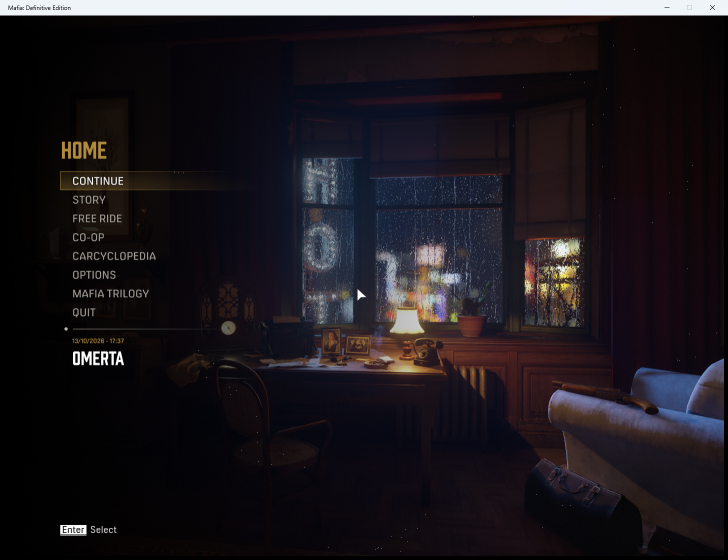
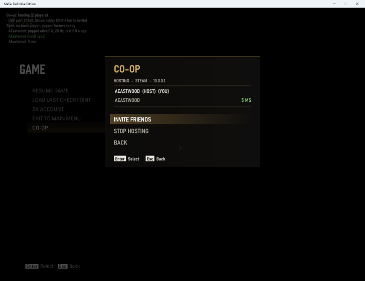
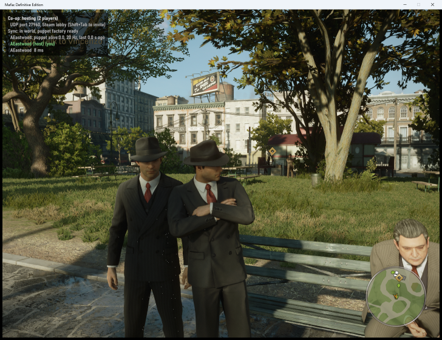
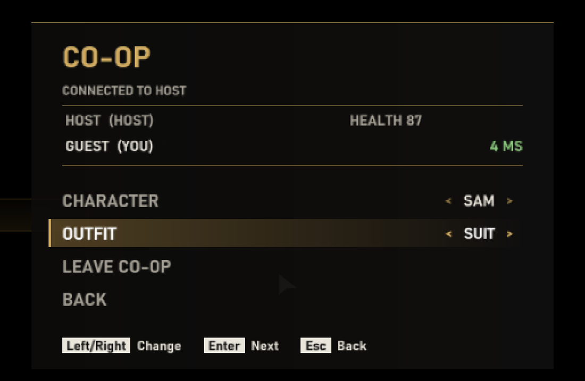
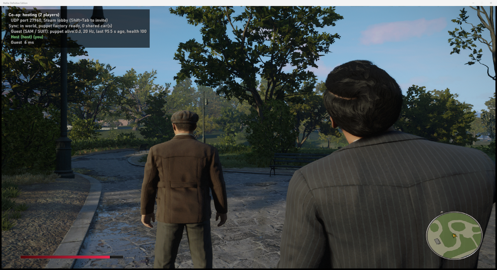
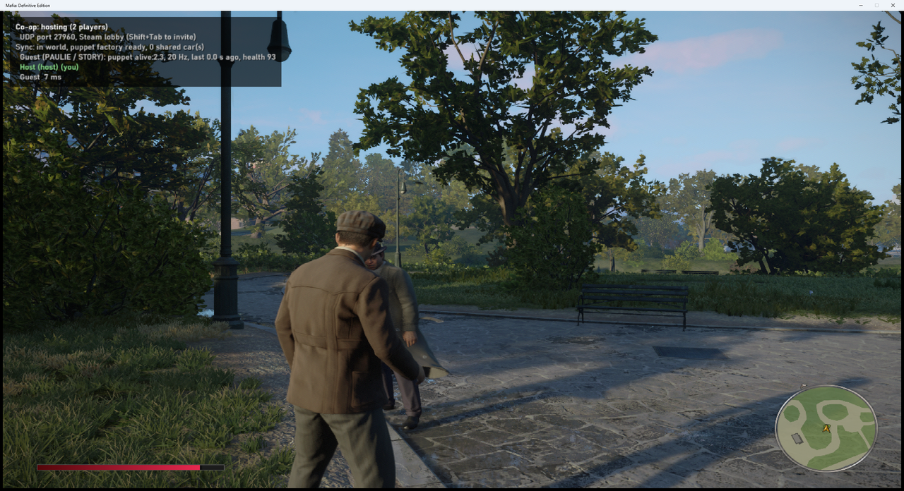
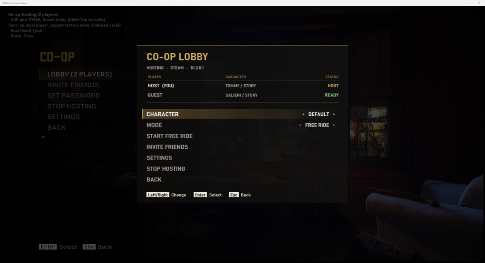
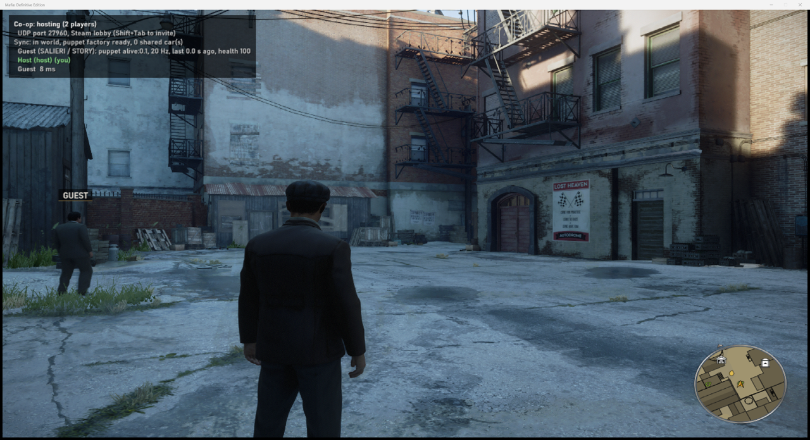

# Mafia: Definitive Edition — Co-op

**Status: in development, playable but not optimal.** A from-scratch co-op mod: one small DLL, no separate
server, Steam invites. Players see each other walking, running, armed and driving, can shoot, punch and run each
other over, and each picks the character he plays as. Weather, time and the story follow the host (chapter,
checkpoint, objectives, cutscenes); mission NPCs are kept in step with the host's (deaths, your hits on them) and
mission cars are not doubled. Enemies on the host's screen do not aim at the other players yet, and ambient traffic
is each player's own.

## Download

The current version is the **0.8.0 pre-release**: download `MafiaCoop-0.8.0.zip` from
[Releases](https://github.com/JustAddMP/MafiaDE/releases), extract it anywhere and read its `README.txt` (requirements,
how to play, known issues, uninstall). Changes per version: [CHANGELOG.md](CHANGELOG.md).

## What you need

- Windows 10/11 (64-bit) and Mafia: Definitive Edition on Steam (build 16502642, the current one), with Steam running

## Play

1. Run `MafiaCoop.exe`. It starts the game with co-op built in.
2. Host: choose **CO-OP → Host Co-op Game** in the main menu. The co-op lobby opens: invite friends (or let them join
   by IP), wait until everyone is ready, pick the mode and press **START**: **FREE RIDE**, **STORY** (the host
   continues his story; everyone else joins him at his checkpoint) or a **CHAPTER** from its start. In the story the
   friends follow the host: his checkpoints, objectives and cutscenes. A friend's game saves nothing into his own
   save slots while he is in a co-op game (story or Free Ride), and neither does the host's in a CHAPTER (that chapter
   is not his story); the host of a STORY game saves his own story as in single player.
3. Join: accept the Steam invite, or choose **CO-OP → Join by IP**. You land in the lobby: pick your character and
   set **READY**.
4. Your character: pause menu → **CO-OP** → **CHARACTER** / **OUTFIT** (Left/Right). Tommy, Paulie, Sam, Salieri,
   Frank and more of the story cast; everyone sees the change at once, and your pick is remembered.
5. In the world the other players' names float over them and they show on your minimap. Name, name tags, map
   markers and friendly fire: **CO-OP → SETTINGS**.

## Start from Steam (optional)

To start the game from Steam as usual and still have co-op, run `MafiaCoop.exe --install` once (from a command
prompt in the MafiaCoop folder). It asks first, then puts two small files into the game folder: `version.dll` (loads
MafiaCoop when the game starts) and `mafiacoop_path.txt` (where your MafiaCoop folder is). Keep the MafiaCoop folder
where it is; settings come from `MafiaCoop.ini` next to `mafiacoop.dll`. If another mod already uses a
`version.dll`, MafiaCoop changes nothing and tells you. To remove it, run `MafiaCoop.exe --uninstall` (or delete
those two files); it only ever deletes its own files.

## Known issues

- Enemies: shared in fights (deaths both ways, health, the host's enemies aim at friends too) but tested in one
  chapter's shootout only (Bon Appetit's restaurant, not played to its end). Each game spawns a fight's later waves
  when its own player gets there: stay together, or an enemy only the host's game spawned shoots at a friend unseen.
- Mission cars are partly shared (the host sits at the wheel of a mission car on a friend's screen, checked in Taxi
  and Bon Appetit; handing the car back when he gets out is not checked); ambient traffic, pedestrians and police are
  each player's own.
- Story co-op was tested in a few chapters (Omerta, Taxi, Bon Appetit) and a few more chapter starts only.
- A failed mission in a co-op CHAPTER (and a friend's failed mission in any co-op game) goes back to the checkpoint
  in two loads: a short stop in a Free Ride world (confirmed for you and kept black, if the game window has focus),
  then the checkpoint. Leaving the area and a destroyed mission car were tested; a mission timer was not.
- A killed game (not closed) makes the others wait about 4.5 s; there is no automatic reconnect.
- The co-op panels were tested with a virtual gamepad and mouse messages, not a physical gamepad; Steam invites
  between two PCs not fully tested.

## For developers

Source, build steps and design notes: `README-dev.md` and `docs/`. The game-agnostic part (launcher, networking,
overlay, co-op UI) is [JustAddMP/core](https://github.com/JustAddMP/core), a git submodule in `external/core`
(clone with `git clone --recursive`, or run `git submodule update --init`).

## Screenshots

| | |
|---|---|
|  |  |
| CO-OP entry in the game's own main menu | The co-op page while hosting |
|  |  |
| Pause menu: players, ping, invite friends | Host's view: the guest standing next to them |
|  |  |
| Guest's view after joining mid-game | Picking a character and outfit in the co-op panel |
|  |  |
| Host's view: the guest picked Sam in a suit | Punching the other player hurts him on his own game |
|  |  |
| The lobby: characters, ready, mode, start | Free Ride together: the guest's name and his marker on the minimap |
