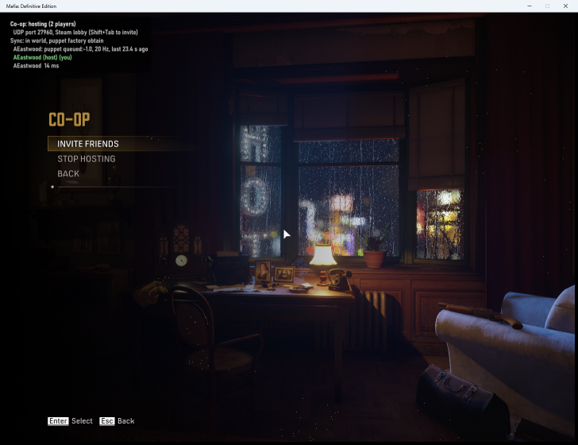
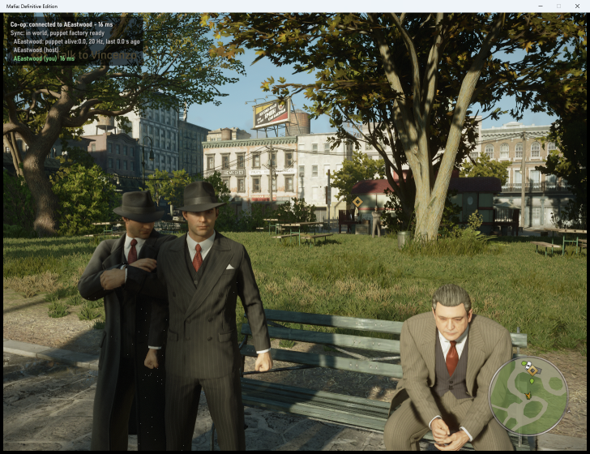

# Mafia: Definitive Edition — Co-op

**Status: in development, playable but not optimal.** A from-scratch co-op mod: one small DLL, no separate
server, Steam invites. Players see each other walking, running, armed and driving. The host's NPCs, traffic,
weather and missions are not shared yet.

## What you need

- Windows 10/11 (64-bit) and Mafia: Definitive Edition on Steam, with Steam running

## Play

1. Run `MafiaCoop.exe`. It starts the game with co-op built in.
2. Host: choose **CO-OP → Host Co-op Game** in the main menu, then invite friends from the pause menu or the
   Steam overlay (Shift+Tab).
3. Join: accept the Steam invite, or choose **CO-OP → Join by IP**.

## Start from Steam (optional)

To start the game from Steam as usual and still have co-op, run `MafiaCoop.exe --install` once (from a command
prompt in the MafiaCoop folder). It asks first, then puts two small files into the game folder: `version.dll` (loads
MafiaCoop when the game starts) and `mafiacoop_path.txt` (where your MafiaCoop folder is). Keep the MafiaCoop folder
where it is; settings come from `MafiaCoop.ini` next to `mafiacoop.dll`. If another mod already uses a
`version.dll`, MafiaCoop changes nothing and tells you. To remove it, run `MafiaCoop.exe --uninstall` (or delete
those two files); it only ever deletes its own files.

## For developers

Source, build steps and design notes are in `native/` (`native/README-dev.md`, `native/docs/`).

## Screenshots

| | |
|---|---|
|  |  |
| CO-OP entry in the game's own main menu | The co-op page while hosting |
|  |  |
| Pause menu: players, ping, invite friends | Host's view: the guest standing next to them |
|  | |
| Guest's view after joining mid-game | |
